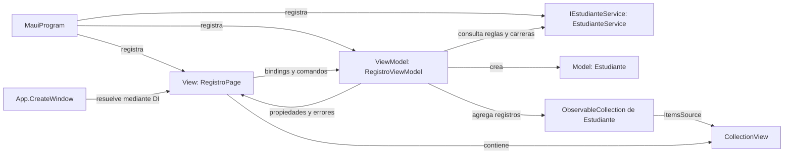
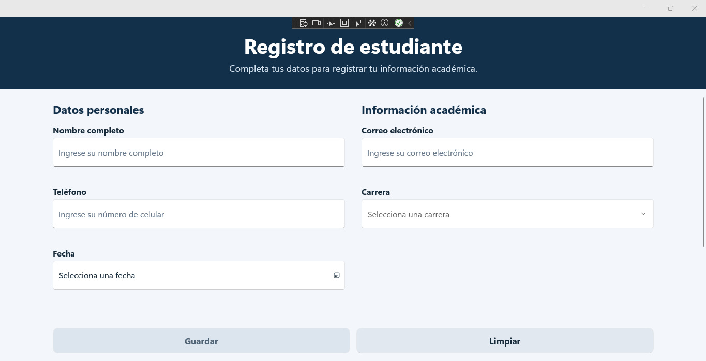
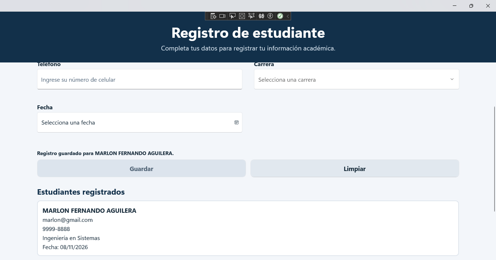

# Registro de estudiantes — Presentación 5: Arquitectura MVVM

Aplicación académica de registro de estudiantes desarrollada con C# y .NET MAUI 10. Permite introducir datos, validarlos, registrar estudiantes y consultar la lista durante la sesión.

El objetivo de la **Presentación 5 – Arquitectura MVVM** es demostrar separación de responsabilidades, propiedades observables, bindings compilados, comandos con `CanExecute`, una colección observable e inyección de dependencias.

Los registros permanecen **en memoria** en el ViewModel de la página. Se pierden al cerrar la aplicación; no hay base de datos, autenticación ni servicios externos.

## Tecnologías

- .NET 10 y .NET MAUI; destinos comprobados: Windows y Android.
- C# y XAML con `x:DataType` y generación XAML mediante `MauiXamlInflator=SourceGen`.
- CommunityToolkit.Mvvm 8.4.0: `ObservableObject`, `[ObservableProperty]` y `[RelayCommand]`.
- Inyección de dependencias de .NET y `Microsoft.Extensions.Logging.Debug`.

La versión de Microsoft.Maui.Controls procede de `$(MauiVersion)` en el entorno de compilación; en la auditoría se resolvió MAUI 10.0.20. El proyecto también declara iOS y Mac Catalyst mediante condiciones de plataforma, pero no se verificaron esos destinos.

## Estructura del repositorio

```text
RegistroEstudiantesMVVM/
├── RegistroEstudianteMAUI.slnx
├── RegistroEstudianteMAUI/
│   ├── Models/Estudiante.cs
│   ├── ViewModels/RegistroViewModel.cs
│   ├── Views/RegistroPage.xaml
│   ├── Views/RegistroPage.xaml.cs
│   ├── Services/IEstudianteService.cs
│   ├── Services/EstudianteService.cs
│   ├── Resources/                  # Estilos, colores, fuentes, imágenes e iconos
│   ├── Platforms/                  # Inicio y configuración de cada plataforma
│   ├── Properties/launchSettings.json
│   ├── App.xaml
│   ├── App.xaml.cs
│   ├── AppShell.xaml y AppShell.xaml.cs
│   ├── MainPage.xaml y MainPage.xaml.cs
│   ├── MauiProgram.cs
│   └── RegistroEstudianteMAUI.csproj
├── tests/RegistroEstudianteMAUI.FunctionalTests/
├── docs/
│   ├── capturas/                   # Dos evidencias reales de la aplicación
│   └── auditoria/                  # Informe final, comprobaciones e historial técnico
├── EVIDENCIAS-PARA-INFORME.md
├── README.md
└── .gitignore
```

`App.CreateWindow` resuelve `RegistroPage` mediante DI. Los archivos `AppShell` y `MainPage` son remanentes conservados y no participan en el arranque actual. El ejecutable de pruebas se ejecuta por separado: no está incluido en la solución `.slnx`.

## Arquitectura MVVM

| Componente | Implementación y responsabilidad |
|---|---|
| Model | [Estudiante](RegistroEstudianteMAUI/Models/Estudiante.cs) representa Nombre, Correo, Telefono, Carrera y Fecha. |
| View | [RegistroPage.xaml](RegistroEstudianteMAUI/Views/RegistroPage.xaml) presenta el formulario, mensajes y lista. Su code-behind asigna el BindingContext recibido y ajusta la presentación nativa de Fecha y Carrera en Windows; no valida ni registra datos. |
| ViewModel | [RegistroViewModel](RegistroEstudianteMAUI/ViewModels/RegistroViewModel.cs) expone datos observables, errores individuales, comandos y la colección de estudiantes. |
| Service | [IEstudianteService](RegistroEstudianteMAUI/Services/IEstudianteService.cs) y [EstudianteService](RegistroEstudianteMAUI/Services/EstudianteService.cs) centralizan las reglas y el catálogo de carreras. No acceden a una base de datos. |



### Propiedades observables y bindings compilados

`RegistroViewModel` hereda de `ObservableObject`. El generador de CommunityToolkit.Mvvm convierte los campos con `[ObservableProperty]` en propiedades públicas, como `Nombre`, `Correo`, `Telefono`, `Carrera`, `Fecha` y `Mensaje`, notificando sus cambios.

Cada dato usa `[NotifyPropertyChangedFor]` para actualizar exclusivamente su mensaje de error y `[NotifyCanExecuteChangedFor(nameof(GuardarCommand))]` para reevaluar Guardar. Los métodos parciales `On...Changed` registran qué campos se han modificado.

La página declara `x:DataType="vm:RegistroViewModel"`; la plantilla de CollectionView declara `x:DataType="model:Estudiante"`. Sus bindings se comprueban y generan durante la compilación.

### Validación y comandos

Las reglas están en el servicio y se reutilizan desde el ViewModel:

| Dato | Regla actual |
|---|---|
| Nombre | Obligatorio; letras Unicode, tildes, ñ y espacios. Admite guion y apóstrofo entre nombres; rechaza números y símbolos inapropiados. |
| Correo | Obligatorio; se valida con `MailAddress` y se exige coincidencia con la dirección introducida tras recortar espacios externos. |
| Teléfono | Ocho dígitos ASCII; permite separador entre grupos de cuatro y prefijo opcional `+504`. Ejemplos válidos: `99998888`, `9999-8888`, `+504 9999-8888`. |
| Carrera | Debe pertenecer al catálogo compartido con el Picker. |
| Fecha | Debe estar seleccionada y no ser futura. En el formulario es nullable; en Estudiante se almacena como DateTime. |

No se muestran errores al abrir. Cada advertencia aparece solo después de modificar su campo y desaparece al corregirlo. Esta visibilidad es independiente de la validez general.

`[RelayCommand(CanExecute = nameof(PuedeGuardar))]` genera `GuardarCommand`: el servicio debe aceptar **todos** los datos para habilitar Guardar, aunque haya errores todavía ocultos. Al guardar se agrega un Estudiante a `ObservableCollection<Estudiante>`, se muestra confirmación y se limpia el formulario. `CollectionView.ItemsSource` está enlazado a esa colección y recibe las notificaciones de actualización.

`LimpiarCommand` vacía los campos, los estados de interacción y los mensajes; conserva los estudiantes registrados y deja Guardar deshabilitado. Ni la validación ni los comandos alteran el texto del Entry mientras el usuario escribe.

### Inyección de dependencias

[MauiProgram.cs](RegistroEstudianteMAUI/MauiProgram.cs) registra:

```csharp
builder.Services.AddSingleton<IEstudianteService, EstudianteService>();
builder.Services.AddTransient<RegistroViewModel>();
builder.Services.AddTransient<RegistroPage>();
```

La página recibe el ViewModel por constructor; este recibe `IEstudianteService`. `App.CreateWindow` solicita la página al contenedor.

## Compilar, ejecutar y comprobar

Requisitos: Windows con SDK .NET 10, workload MAUI para Windows y Windows SDK. Para Android se necesitan también su workload, SDK y JDK. Visual Studio con las herramientas MAUI permite seleccionar el destino Windows y ejecutar mediante F5. Para probar Android se requiere emulador o dispositivo, aunque su compilación no exige tener uno conectado.

Desde PowerShell en la raíz, si aún no se restauraron las dependencias del destino:

```powershell
dotnet restore .\RegistroEstudianteMAUI\RegistroEstudianteMAUI.csproj -p:TargetFrameworks=net10.0-windows10.0.19041.0
```

Con las dependencias disponibles, estos comandos se ejecutaron correctamente en la auditoría:

```powershell
dotnet build .\RegistroEstudianteMAUI\RegistroEstudianteMAUI.csproj -f net10.0-windows10.0.19041.0 --no-restore
```

Para ejecutar exactamente la compilación Windows comprobada (Debug, win-x64, aplicación sin empaquetar):

```powershell
& .\RegistroEstudianteMAUI\bin\Debug\net10.0-windows10.0.19041.0\win-x64\RegistroEstudianteMAUI.exe
```

Esta ruta corresponde al entorno Windows x64 utilizado; Visual Studio es la alternativa si se compila con otra configuración o arquitectura. El ejecutable se inició durante la auditoría final. Compilar y ejecutar no equivalen a completar todas las pruebas visuales.

Para Android, restaurar su destino si hace falta y compilar:

```powershell
dotnet restore .\RegistroEstudianteMAUI\RegistroEstudianteMAUI.csproj -p:TargetFrameworks=net10.0-android
dotnet build .\RegistroEstudianteMAUI\RegistroEstudianteMAUI.csproj -f net10.0-android --no-restore
```

Las restauraciones indicadas requieren acceso a NuGet si faltan paquetes y no se repitieron en esta auditoría: se utilizaron las dependencias existentes. Restaurar solo un destino puede requerir restaurar nuevamente el otro antes de compilarlo.

### Pruebas automatizadas

```powershell
dotnet run --project .\tests\RegistroEstudianteMAUI.FunctionalTests
```

Con dependencias ya restauradas, la variante comprobada fue:

```powershell
dotnet run --project .\tests\RegistroEstudianteMAUI.FunctionalTests --no-restore
```

El proyecto de pruebas es un ejecutable de consola que compila los mismos fuentes de Model, Service y ViewModel. No usa un framework de pruebas: se ejecuta con `dotnet run`, no con `dotnet test`. Comprueba 67 escenarios y condiciones de validación, notificación, comandos, limpieza y colección. Estas pruebas no automatizan los controles nativos de la aplicación.

Resultado de la revisión final: Windows, 0 errores y 6 advertencias existentes `MVVMTK0045` sobre AOT/WinRT; Android, 0 errores y 0 advertencias; 67 comprobaciones correctas. La consulta de vulnerabilidades de NuGet de las pruebas informa `NU1900` por falta de acceso al origen remoto. Detalles y límites en el [informe final](docs/auditoria/FINAL.md).

## Capturas reales

Se conservan las evidencias proporcionadas, sin generarlas ni reemplazarlas.





## Entrega y publicación

La [matriz de cumplimiento académico](docs/auditoria/FINAL.md#matriz-de-cumplimiento-académico) documenta los siete requisitos y las dos evidencias adicionales. [EVIDENCIAS-PARA-INFORME.md](EVIDENCIAS-PARA-INFORME.md) facilita la revisión del código y las capturas.

`.gitignore` excluye `.vs`, `bin`, `obj`, archivos de usuario de Visual Studio y resultados de pruebas. La carpeta local auditada no contiene `.git`: todavía deben inicializarse o recuperarse el repositorio local, revisar los archivos a incluir y crear el primer commit. No se ha configurado ni modificado un remoto ni se ha ejecutado `git push`.